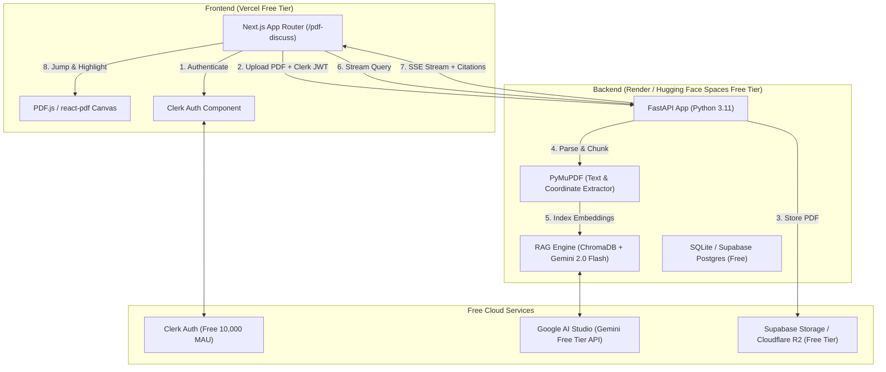

# End-to-End Zero-Cost Guide: Building & Deploying the Real-Time PDF Discuss RAG Application

This guide provides a complete, step-by-step roadmap to transform your current **/pdf-discuss** frontend into a fully functional, production-ready, real-time RAG (Retrieval-Augmented Generation) document intelligence platform **entirely free of cost ($0.00)**.

---

## 1. The 100% Free Production Architecture



### Free Services & Limits Overview
- **LLM & Embeddings**: Google Gemini 2.0 Flash / 1.5 Flash via [Google AI Studio](https://aistudio.google.com/) — **15 RPM**, **1,500 requests/day**, **1M token context**, **$0.00** without a credit card.
- **Frontend Hosting**: [Vercel Hobby Plan](https://vercel.com/) — Unlimited deployments, automated CI/CD from GitHub, custom domains, HTTPS included.
- **Backend Hosting**: [Render.com Web Services (Free Tier)](https://render.com/) or [Hugging Face Spaces (Free Docker Tier)](https://huggingface.co/spaces) — 512 MB RAM, runs FastAPI smoothly.
- **Vector Database**: **ChromaDB** running locally in Python with persistent SQLite file storage, or [Pinecone Starter](https://www.pinecone.io/) (1 free index).
- **Authentication**: [Clerk](https://clerk.com/) — 10,000 monthly active users free.
- **Document Storage**: [Supabase Storage](https://supabase.com/) (1 GB free storage) or [Cloudflare R2](https://www.cloudflare.com/developer-platform/r2/) (10 GB free storage/mo).

---

## 2. Phase 1: Local Backend Construction (`/backend`)

### Step 1: Initialize Python Environment
From your project root `d:\PDF-Explain-RAG`:

```powershell
cd d:\PDF-Explain-RAG\backend
python -m venv venv
.\venv\Scripts\Activate.ps1
```

### Step 2: Create `backend/requirements.txt`
```text
fastapi>=0.115.0
uvicorn[standard]>=0.30.0
python-multipart>=0.0.9
pymupdf>=1.24.0
google-genai>=0.1.0
chromadb>=0.5.0
pydantic>=2.7.0
python-dotenv>=1.0.0
httpx>=0.27.0
```

Install packages:
```powershell
pip install -r requirements.txt
```

### Step 3: Create Backend Architecture

```
backend/
├── app/
│   ├── __init__.py
│   ├── main.py              # FastAPI application & endpoints
│   ├── config.py            # Environment configurations
│   ├── services/
│   │   ├── __init__.py
│   │   ├── parser.py        # PyMuPDF text & page extraction
│   │   ├── vector_store.py  # ChromaDB indexing & similarity retrieval
│   │   └── rag_engine.py    # Gemini streaming & strict citation prompting
│   └── database/
│       ├── __init__.py
│       └── models.py        # SQLite metadata & conversation history
├── uploads/                 # Local storage for uploaded PDFs
├── chroma_db/               # Persistent ChromaDB vector data
├── .env                     # Local environment variables
└── requirements.txt
```

### Step 4: Core Implementation Code

#### 1. Configuration: `backend/app/config.py`
```python
import os
from dotenv import load_dotenv

load_dotenv()

GEMINI_API_KEY = os.getenv("GEMINI_API_KEY", "")
UPLOAD_DIR = os.getenv("UPLOAD_DIR", "./uploads")
CHROMA_DIR = os.getenv("CHROMA_DIR", "./chroma_db")
ALLOWED_ORIGINS = os.getenv("ALLOWED_ORIGINS", "http://localhost:3000").split(",")

os.makedirs(UPLOAD_DIR, exist_ok=True)
os.makedirs(CHROMA_DIR, exist_ok=True)
```

#### 2. PDF Parser: `backend/app/services/parser.py`
```python
import fitz  # PyMuPDF
from typing import List, Dict, Any

def extract_pdf_pages(file_path: str) -> List[Dict[str, Any]]:
    """
    Extracts text per page along with metadata and bounding boxes.
    """
    doc = fitz.open(file_path)
    pages_data = []

    for page_num in range(len(doc)):
        page = doc[page_num]
        text = page.get_text("text").strip()
        
        # Extract blocks for structural extraction
        blocks = page.get_text("blocks")
        cleaned_blocks = []
        for b in blocks:
            if b[4].strip():  # non-empty text
                cleaned_blocks.append({
                    "bbox": [round(coord, 1) for coord in b[:4]], # [x0, y0, x1, y1]
                    "text": b[4].strip()
                })

        pages_data.append({
            "page_number": page_num + 1,
            "text": text,
            "blocks": cleaned_blocks,
            "width": page.rect.width,
            "height": page.rect.height
        })

    doc.close()
    return pages_data
```

#### 3. Vector Storage: `backend/app/services/vector_store.py`
```python
import chromadb
from chromadb.config import Settings
from app.config import CHROMA_DIR
from typing import List, Dict, Any

chroma_client = chromadb.PersistentClient(path=CHROMA_DIR)

def get_or_create_collection(doc_id: str):
    # Sanitize collection name for ChromaDB
    col_name = f"doc_{doc_id.replace('-', '_')}"[:63]
    return chroma_client.get_or_create_collection(name=col_name)

def index_document_chunks(doc_id: str, chunks: List[Dict[str, Any]]):
    collection = get_or_create_collection(doc_id)
    
    ids = [f"{doc_id}_{idx}" for idx in range(len(chunks))]
    documents = [c["text"] for c in chunks]
    metadatas = [
        {
            "doc_id": doc_id,
            "page": c["page"],
            "chunk_index": idx
        }
        for idx, c in enumerate(chunks)
    ]
    
    collection.add(
        ids=ids,
        documents=documents,
        metadatas=metadatas
    )

def query_relevant_chunks(doc_id: str, query: str, top_k: int = 5):
    collection = get_or_create_collection(doc_id)
    results = collection.query(
        query_texts=[query],
        n_results=top_k
    )
    
    matched = []
    if results and results["documents"]:
        docs = results["documents"][0]
        metas = results["metadatas"][0]
        for d, m in zip(docs, metas):
            matched.append({"text": d, "metadata": m})
    return matched
```

#### 4. Streaming RAG with Gemini: `backend/app/services/rag_engine.py`
```python
import json
from google import genai
from google.genai import types
from app.config import GEMINI_API_KEY
from app.services.vector_store import query_relevant_chunks

client = genai.Client(api_key=GEMINI_API_KEY)

async def stream_rag_response(doc_id: str, doc_name: str, question: str):
    """
    Retrieves context and streams Gemini tokens via Server-Sent Events (SSE).
    """
    # 1. Retrieve grounded context
    chunks = query_relevant_chunks(doc_id, question, top_k=5)
    
    context_str = "\n\n".join(
        [f"[Page {c['metadata']['page']}]: {c['text']}" for c in chunks]
    )

    system_instruction = f"""
You are an expert AI document intelligence assistant analyzing "{doc_name}".
Rules for strict grounding:
1. Base your answer SOLELY on the provided context below.
2. For EVERY key claim or metric, attach exact page citations in brackets like [Page X].
3. If the answer cannot be determined from the provided context, clearly state: "This information is not found in the provided document."
4. Format responses cleanly with markdown bullet points and structured tables where helpful.

Context:
{context_str}
"""

    # First emit the retrieved citations metadata
    citations = [
        {"page": c["metadata"]["page"], "excerpt": c["text"][:120]}
        for c in chunks
    ]
    yield f"data: {json.dumps({'type': 'citations', 'citations': citations})}\n\n"

    # 2. Stream Gemini LLM response
    response = client.models.generate_content_stream(
        model="gemini-2.0-flash",
        contents=question,
        config=types.GenerateContentConfig(
            system_instruction=system_instruction,
            temperature=0.2, # low temperature for strict factual accuracy
        )
    )

    for chunk in response:
        if chunk.text:
            yield f"data: {json.dumps({'type': 'token', 'token': chunk.text})}\n\n"

    yield f"data: {json.dumps({'type': 'done'})}\n\n"
```

#### 5. FastAPI Endpoints: `backend/app/main.py`
```python
import os
import uuid
import shutil
from fastapi import FastAPI, UploadFile, File, Form, HTTPException
from fastapi.middleware.cors import CORSMiddleware
from fastapi.responses import StreamingResponse, FileResponse
from app.config import ALLOWED_ORIGINS, UPLOAD_DIR
from app.services.parser import extract_pdf_pages
from app.services.vector_store import index_document_chunks
from app.services.rag_engine import stream_rag_response

app = FastAPI(title="PDF-Explain-RAG Backend")

app.add_middleware(
    CORSMiddleware,
    allow_origins=ALLOWED_ORIGINS,
    allow_credentials=True,
    allow_methods=["*"],
    allow_headers=["*"],
)

# In-memory document registry (can be backed by SQLite)
DOCUMENTS_STORE = {}

@app.post("/api/documents/upload")
async def upload_pdf(file: UploadFile = File(...)):
    if not file.filename.lower().endswith(".pdf"):
        raise HTTPException(status_code=400, detail="Only PDF files are supported.")

    doc_id = str(uuid.uuid4())
    file_path = os.path.join(UPLOAD_DIR, f"{doc_id}_{file.filename}")

    with open(file_path, "wb") as buffer:
        shutil.copyfileobj(file.file, buffer)

    # Extract text per page
    pages_data = extract_pdf_pages(file_path)

    # Chunking strategy (1 page per chunk or sliding window)
    chunks = []
    for p in pages_data:
        chunks.append({
            "page": p["page_number"],
            "text": p["text"]
        })

    # Index into ChromaDB
    index_document_chunks(doc_id, chunks)

    doc_info = {
        "id": doc_id,
        "name": file.filename,
        "totalPages": len(pages_data),
        "fileSize": f"{round(os.path.getsize(file_path) / (1024 * 1024), 2)} MB",
        "filePath": file_path,
        "pages": {p["page_number"]: p for p in pages_data}
    }
    DOCUMENTS_STORE[doc_id] = doc_info

    return {"status": "success", "document": doc_info}

@app.get("/api/documents/{doc_id}/file")
async def get_pdf_file(doc_id: str):
    if doc_id not in DOCUMENTS_STORE:
        raise HTTPException(status_code=404, detail="Document not found")
    return FileResponse(DOCUMENTS_STORE[doc_id]["filePath"], media_type="application/pdf")

@app.get("/api/documents")
async def list_documents():
    return {"documents": list(DOCUMENTS_STORE.values())}

@app.post("/api/chat/stream")
async def chat_stream(doc_id: str = Form(...), message: str = Form(...)):
    if doc_id not in DOCUMENTS_STORE:
        raise HTTPException(status_code=404, detail="Document not found")
    
    doc_name = DOCUMENTS_STORE[doc_id]["name"]
    return StreamingResponse(
        stream_rag_response(doc_id, doc_name, message),
        media_type="text/event-stream"
    )

if __name__ == "__main__":
    import uvicorn
    uvicorn.run("app.main:app", host="0.0.0.0", port=8000, reload=True)
```

---

## 3. Phase 2: Frontend Wiring (`frontend/app/pdf-discuss`)

### Step 1: Install Real PDF Engine
```powershell
cd d:\PDF-Explain-RAG\frontend
npm install react-pdf pdfjs-dist
```

### Step 2: Wire the Upload Modal to the Backend
In [pdf-discuss/page.tsx](file:///d:/PDF-Explain-RAG/frontend/app/pdf-discuss/page.tsx), replace the mock file drop with real upload logic:

```typescript
const handleFileUpload = async (file: File) => {
  setIsUploading(true);
  const formData = new FormData();
  formData.append("file", file);

  try {
    const res = await fetch("http://localhost:8000/api/documents/upload", {
      method: "POST",
      body: formData,
    });
    const data = await res.json();
    if (data.status === "success") {
      setDocuments((prev) => [data.document, ...prev]);
      setSelectedDocId(data.document.id);
      setUploadModalOpen(false);
    }
  } catch (err) {
    console.error("Upload error:", err);
  } finally {
    setIsUploading(false);
  }
};
```

### Step 3: Wire Streaming Chat SSE Reader
Replace the mock `setTimeout` in `handleSendMessage`:

```typescript
const handleSendMessage = async () => {
  if (!inputQuestion.trim() || isAiThinking) return;

  const userQuestion = inputQuestion.trim();
  setInputQuestion("");

  // Append user message immediately
  const userMsgId = `usr-${Date.now()}`;
  setChatMessages((prev) => [
    ...prev,
    { id: userMsgId, sender: "user", text: userQuestion, timestamp: "Just now" },
  ]);

  // Create temporary streaming AI message
  const aiMsgId = `ai-${Date.now()}`;
  setChatMessages((prev) => [
    ...prev,
    { id: aiMsgId, sender: "ai", text: "", timestamp: "Just now", citationPills: [] },
  ]);
  setIsAiThinking(true);

  const formData = new FormData();
  formData.append("doc_id", selectedDocId);
  formData.append("message", userQuestion);

  const response = await fetch("http://localhost:8000/api/chat/stream", {
    method: "POST",
    body: formData,
  });

  const reader = response.body?.getReader();
  const decoder = new TextDecoder();

  if (!reader) return;

  while (true) {
    const { done, value } = await reader.read();
    if (done) break;

    const chunk = decoder.decode(value);
    const lines = chunk.split("\n\n");

    for (const line of lines) {
      if (line.startsWith("data: ")) {
        const payload = JSON.parse(line.replace("data: ", ""));

        if (payload.type === "citations") {
          setChatMessages((prev) =>
            prev.map((msg) =>
              msg.id === aiMsgId
                ? {
                    ...msg,
                    citationPills: payload.citations.map((c: any) => ({
                      tag: `Page ${c.page}`,
                      page: c.page,
                      textExcerpt: c.excerpt,
                    })),
                  }
                : msg
            )
          );
        } else if (payload.type === "token") {
          setChatMessages((prev) =>
            prev.map((msg) =>
              msg.id === aiMsgId ? { ...msg, text: msg.text + payload.token } : msg
            )
          );
        }
      }
    }
  }

  setIsAiThinking(false);
};
```

---

## 4. Phase 3: 100% Free Online Deployment Guide

### A. Deploy Backend for Free (Render.com)

1. **Create `Dockerfile` in `backend/`**:
   ```dockerfile
   FROM python:3.11-slim
   WORKDIR /app
   COPY requirements.txt .
   RUN pip install --no-cache-dir -r requirements.txt
   COPY . .
   EXPOSE 8000
   CMD ["uvicorn", "app.main:app", "--host", "0.0.0.0", "--port", "8000"]
   ```
2. **Push your code to GitHub** (public or private repository).
3. **Deploy on Render**:
   - Go to [dashboard.render.com](https://dashboard.render.com/) → Click **New Web Service**.
   - Connect your GitHub repository.
   - Root directory: `backend`.
   - Environment: `Python 3` or `Docker`.
   - Instance Type: **Free** (512 MB RAM).
   - Add Environment Variables:
     - `GEMINI_API_KEY`: *(Your key from Google AI Studio)*
     - `ALLOWED_ORIGINS`: `https://your-app.vercel.app`
   - Click **Deploy**. Render will provide a free live URL: `https://your-backend.onrender.com`.

> [!TIP]
> **Alternative Free Backend**: You can also deploy the backend as a **Hugging Face Space** using the free Docker SDK. Hugging Face Spaces free tier offers 16 GB RAM and 2 vCPUs without sleeping.

---

### B. Deploy Frontend for Free (Vercel)

1. **Update Frontend Environment Variables**:
   In `frontend/`:
   ```env
   NEXT_PUBLIC_CLERK_PUBLISHABLE_KEY=pk_test_...
   CLERK_SECRET_KEY=sk_test_...
   NEXT_PUBLIC_BACKEND_URL=https://your-backend.onrender.com
   ```
2. **Deploy on Vercel**:
   - Go to [vercel.com](https://vercel.com/) → Click **Add New Project**.
   - Select your GitHub repo.
   - Root directory: `frontend`.
   - Framework preset: `Next.js`.
   - Paste the environment variables (`NEXT_PUBLIC_CLERK_PUBLISHABLE_KEY`, `CLERK_SECRET_KEY`, `NEXT_PUBLIC_BACKEND_URL`).
   - Click **Deploy**. Vercel will build and give you a free production URL: `https://pdf-explain-rag.vercel.app`.

---

### C. Connect Clerk for Production

1. Open your [Clerk Dashboard](https://dashboard.clerk.com/).
2. Under **Configure** → **Paths & Domains**:
   - Add your production domain: `https://pdf-explain-rag.vercel.app`.
   - Set the sign-in and sign-up redirect paths to `/pdf-discuss`.

---

## 5. Free-Tier Optimization & Best Practices

1. **Render Free Tier Cold Starts**:
   - Free instances on Render spin down after 15 minutes of inactivity. The first request takes ~30 seconds to wake up.
   - *Fix*: Use a free cron ping (e.g., [cron-job.org](https://cron-job.org/) pinging `/api/documents` every 14 minutes) or host on Hugging Face Spaces which stays awake.
2. **Gemini Free Tier Rate Limits**:
   - 15 requests per minute (RPM) is plenty for individual and small team usage.
   - Set `temperature=0.1` or `0.2` for deterministic RAG answers without hallucinations.
3. **Storage Cleanup**:
   - Add an auto-cleanup job in FastAPI to delete files older than 48 hours if you want to keep the local disk footprint negligible.
